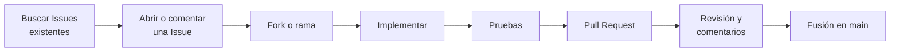

# Cómo contribuir a Web Workshop

Gracias por querer mejorar el laboratorio. Esta guía explica qué tipos de contribución se esperan, cómo proponer cambios y qué se revisa antes de aceptarlos. Está pensada para cualquier miembro de Hackers Factory, tenga o no experiencia con el código.

**Contenido:** [Tipos de contribución](#1-tipos-de-contribución) · [Antes de empezar](#2-antes-de-empezar) · [Flujo de trabajo](#3-flujo-de-trabajo) · [Entorno y pruebas](#4-entorno-y-pruebas) · [Pull Requests](#5-pull-requests) · [Revisión](#6-revisión) · [Decisiones de arquitectura](#decisiones-de-arquitectura) · [Licencia](#licencia)

## 1. Tipos de contribución

No todas las contribuciones son código, y **no todas tienen que ser Pull Requests**. Una buena Issue con una idea, un error bien descrito o el resultado de probar el laboratorio en otra plataforma son igual de valiosos.

| Contribución | Cómo | Necesitas programar |
|---|---|---|
| Comunicar un error | Issue con la plantilla *Informe de error* | No |
| Proponer una funcionalidad nueva | Issue *Nueva funcionalidad* | No |
| Proponer una mejora de algo existente | Issue *Mejora* | No |
| Señalar documentación ausente, confusa o incorrecta | Issue *Documentación*, o un PR si sabes cómo corregirla | No |
| Proponer un laboratorio, escenario o ejercicio nuevo | Issue *Propuesta de laboratorio* | No |
| Probar en una plataforma no probada (Debian, Fedora, VirtualBox, Windows...) | Seguir las [pruebas](docs/testing/pruebas.md) y compartir el resultado en una Issue o un PR a la [matriz de compatibilidad](docs/compatibilidad.md#cómo-contribuir-un-resultado) | No |
| Corregir o ampliar la documentación | Pull Request | No |
| Añadir herramientas al kit de Kali | Pull Request (un archivo `.conf`, [formato](docs/kali/preparacion.md#añadir-herramientas)) | No |
| Integrar un laboratorio aceptado | Pull Request ([guía](docs/development/nuevo-laboratorio.md)) | Algo: Docker Compose y JSON |
| Corregir errores o mejorar el gestor, los instaladores, el firewall o las pruebas | Pull Request ([guía de desarrollo](docs/development/README.md)) | Sí: Python, Bash o PowerShell |
| Avisar de un problema de seguridad del laboratorio | **No en público**: [SECURITY.md](SECURITY.md) | No |

**Colaboradores de contenido** (laboratorios, ejercicios, documentación, pruebas en plataformas nuevas) y **colaboradores técnicos** (gestor, infraestructura, scripts, CI) siguen el mismo flujo; cambia lo que se revisa (ver [Revisión](#6-revisión)).

**Material educativo.** El repositorio contiene la infraestructura y documentación técnica, **sin soluciones ni pistas** sobre las vulnerabilidades. Si quieres aportar material didáctico (guiones de sesión, ejercicios, presentaciones), abre primero una Issue para decidir con los responsables dónde debe vivir: hoy no hay un sitio definido para ello en el repositorio.

## 2. Antes de empezar

- Lee los [principios del proyecto](docs/project/README.md#2-principios). Explican la mayoría de decisiones.
- Si vas a tocar código, `labs/` o `config/`, lee las [invariantes de seguridad](docs/architecture/invariantes-seguridad.md). **Una contribución no es válida solo porque funcione: también debe conservar las garantías de seguridad existentes.**
- Para cambios grandes (un laboratorio, un comando nuevo, otra plataforma), **abre antes una Issue** y espera a que se acepte. Así evitas trabajo que luego no encaje.
- Para correcciones pequeñas (una errata, un enlace roto, un error evidente con su prueba), puedes abrir el Pull Request directamente.

## 3. Flujo de trabajo



1. **Consulta las Issues** abiertas y cerradas. Si ya existe una parecida, comenta en ella.
2. **Abre una Issue** con la plantilla adecuada si no existe ([cómo se evalúan](docs/project/README.md#4-cómo-se-evalúan-las-propuestas)). Si quieres implementarla, dilo en la Issue.
3. **Prepara tu copia:**
   - con permiso de escritura en el repositorio, crea una rama desde `main`;
   - sin él, haz un *fork* en GitHub, clónalo y crea la rama en tu fork.
4. **Crea una rama por cambio**, con un nombre corto y descriptivo. Se sugiere `tipo/descripcion`:

   | Prefijo | Para |
   |---|---|
   | `fix/` | Corrección de errores |
   | `feat/` | Funcionalidad nueva o mejora |
   | `lab/` | Laboratorio nuevo o cambios en uno existente |
   | `docs/` | Documentación |
   | `test/`, `ci/` | Pruebas y CI |

   Por ejemplo: `fix/puerto-ocupado-time-wait`, `docs/kvm-imagen-kali`.
5. **Implementa el cambio** siguiendo las [convenciones](docs/development/README.md#4-convenciones). Mantén el PR centrado en un solo tema.
6. **Ejecuta las pruebas** que correspondan (sección siguiente).
7. **Abre el Pull Request** contra `main`, rellenando la plantilla.
8. **Atiende la revisión.** Responde a los comentarios y añade *commits* nuevos con los cambios; no hace falta reescribir el historial.

### Mensajes de commit

No hay un formato obligatorio. Escríbelos **en español**, con una primera línea corta que diga qué cambia (por ejemplo, *"Corrige la detección de puertos en TIME_WAIT"*) y, si hace falta, un párrafo que explique por qué. Un commit por cambio lógico.

## 4. Entorno y pruebas

El detalle está en la [guía de desarrollo](docs/development/README.md#1-entorno-de-desarrollo). En resumen:

```bash
git clone https://github.com/Hacker-Factory-CTF-Team/Web-Workshop.git   # o tu fork
cd Web-Workshop
python3 -m unittest discover -s tests -t .     # Python ≥ 3.10; sin dependencias
```

- Las pruebas unitarias no necesitan Docker, root ni red. Las de `tests/security/` necesitan la CLI `docker compose` (no crean contenedores) y se omiten si no está.
- Para cambios en laboratorios, red, firewall o instaladores necesitas un anfitrión Linux preparado y las pruebas con paquetes reales.
- La tabla [Qué probar tras cada cambio](docs/testing/pruebas.md#8-qué-probar-tras-cada-cambio) indica las pruebas mínimas para cada tipo de cambio.
- El CI (`.github/workflows/ci.yml`) se ejecuta en cada Pull Request: lint, pruebas unitarias con Python 3.10, 3.12 y 3.13, y un despliegue real con red emulada. **Tiene que pasar.**

Si no puedes ejecutar alguna prueba (por ejemplo, no tienes Windows o una VM de Kali), dilo en el PR. No marques como probado lo que no hayas ejecutado.

## 5. Pull Requests

La [plantilla](.github/pull_request_template.md) pide:

- **Problema que resuelve** y motivación, con la Issue enlazada (`Closes #N`).
- **Descripción de la implementación** y componentes o archivos afectados.
- **Pruebas realizadas** y en qué entorno.
- **Impacto en la seguridad y la arquitectura**: si el cambio toca alguna invariante, explícalo.
- **Documentación actualizada.** Si cambia el comportamiento de un comando, su documentación cambia en el mismo PR.

Consejos:

- PR pequeños y de un solo tema se revisan antes y mejor.
- Si cambia `scripts/linux/pentestlab-fw.sh`, avisa de que hay que reinstalar el firewall (`scripts/linux/install.sh --phase firewall`): el gestor bloquea el arranque hasta entonces.
- Si incorporas una imagen o una versión nueva, sigue el [procedimiento de actualización](docs/management/actualizaciones.md#2-para-mantenedores-incorporar-una-versión-nueva).
- Si el trabajo no está terminado, ábrelo como *Draft*.

## 6. Revisión

Hoy la rama `main` **no tiene reglas de protección configuradas** en GitHub ([configuración pendiente](docs/project/configuracion-github.md#4-protección-de-la-rama-main)). Hasta que las haya, se pide como norma del equipo:

- que el CI esté en verde;
- al menos una revisión de una persona distinta de quien lo ha escrito;
- que los cambios que afecten a la seguridad (etiqueta `seguridad`, o archivos como `policy.py`, `isolation.py`, `pentestlab-fw.sh`, `labs/_common/` o `config/versions.json`) los revise un responsable del proyecto.

Quien revisa comprueba:

| Aspecto | Preguntas |
|---|---|
| **Seguridad** | ¿Se conservan las [invariantes](docs/architecture/invariantes-seguridad.md)? ¿Hay puertos, redes, capacidades, montajes o salidas nuevas? ¿Lo que no comprueba la política (usuario no root del proxy, límites de PIDs) se respeta? |
| **Corrección** | ¿Hace lo que dice? ¿Los errores dicen cómo solucionarlos? ¿El fallo es *fail-closed*? |
| **Pruebas** | ¿Hay pruebas para el cambio y una de regresión si corrige un error? ¿Se han ejecutado las que indica la tabla de pruebas? |
| **Arquitectura** | ¿Respeta los ADR (biblioteca estándar, CLI de Docker, versiones fijadas)? ¿Añade mantenimiento justificado? |
| **Documentación** | ¿Está actualizada? ¿Distingue lo probado de lo no probado? ¿Evita incluir soluciones o pistas? |
| **Contenido educativo** (laboratorios) | ¿Aporta algo frente a lo existente? ¿Funciona sin Internet? ¿Cabe en los recursos de un participante? |

## Decisiones de arquitectura

Si tu propuesta cambia una decisión de fondo (la arquitectura de red, el firewall, el lenguaje del gestor, el fijado de versiones...), añade un ADR nuevo en `docs/adr/` con el siguiente número y las secciones *Contexto*, *Decisión*, *Alternativas descartadas* y *Consecuencias*, como los existentes. Los ADR aceptados no se reescriben: se sustituyen por uno nuevo. Ver la [arquitectura](docs/architecture/README.md#6-decisiones-de-diseño-adr).

## Licencia

El código del repositorio se publica bajo la [licencia MIT](LICENSE). Al contribuir, aceptas que tu aportación se publique bajo esa misma licencia. No añadas código ni recursos de terceros con licencias incompatibles: si un laboratorio necesita un recurso con otra licencia, se descarga durante la instalación y se verifica por SHA-256, como el LDIF de Mutillidae ([ADR 0004](docs/adr/0004-fijado-de-versiones.md)).
