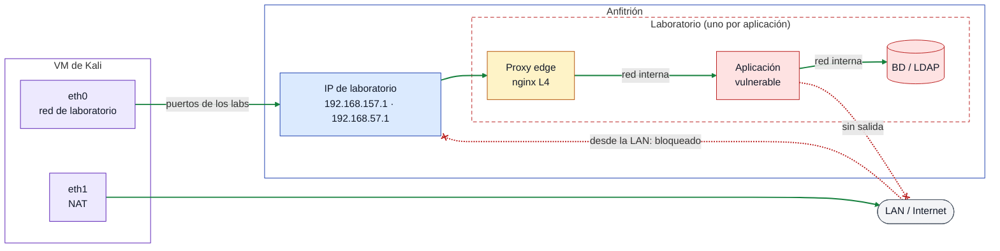

# Web-Workshop: laboratorio local de pentesting web

[](https://github.com/Hacker-Factory-CTF-Team/Web-Workshop/actions/workflows/ci.yml)
[](LICENSE)

Laboratorio **local y aislado** para practicar pruebas de seguridad web: la infraestructura del taller de seguridad web de **Hackers Factory CTF Team**. Cada participante lo ejecuta en su propio equipo: cuatro aplicaciones vulnerables a propósito corren en Docker y se atacan desde una máquina virtual de **Kali Linux** conectada al anfitrión por una red privada.

Resuelve un problema concreto del taller: que todo el mundo tenga las mismas aplicaciones, en las mismas versiones, sin depender de un servidor compartido y **sin poner en riesgo su equipo ni su red**. Un gestor comprueba el aislamiento antes de exponer nada.

| Aplicación | Tecnología | Puertos | Ficha técnica |
|---|---|---|---|
| [DVWA](https://github.com/digininja/DVWA) | PHP + MariaDB | 4280 | [dvwa.md](docs/labs/dvwa.md) |
| [OWASP Juice Shop](https://github.com/juice-shop/juice-shop) | Node.js + Angular + SQLite | 3000 | [juice-shop.md](docs/labs/juice-shop.md) |
| [OWASP WebGoat](https://github.com/WebGoat/WebGoat) + WebWolf | Java / Spring Boot | 8080 / 9090 | [webgoat.md](docs/labs/webgoat.md) |
| [OWASP Mutillidae II](https://github.com/webpwnized/mutillidae-docker) | PHP + MariaDB + OpenLDAP | 8081 / 8443 (HTTPS) | [mutillidae.md](docs/labs/mutillidae.md) |

> [!WARNING]
> **Estas aplicaciones son vulnerables de forma intencionada.** Úsalas solo en este laboratorio.
> - No las expongas a Internet ni a tu red local.
> - No cambies la configuración de red para "hacerlas accesibles" desde otros equipos.
> - Ataca únicamente las aplicaciones del laboratorio.
>
> El gestor **bloquea el despliegue** si detecta que no se cumple el aislamiento (*fail-closed*).

La documentación es solo técnica: no incluye soluciones ni pistas. La idea es que cada participante investigue las aplicaciones por su cuenta.

**Contenido:** [Cómo funciona](#cómo-funciona) · [Inicio rápido](#inicio-rápido) · [Acceso a las aplicaciones](#acceso-a-las-aplicaciones) · [Requisitos](#requisitos) · [Documentación](#documentación) · [Participar](#participar) · [Seguridad](#seguridad) · [Licencia](#licencia)

## Cómo funciona



En verde, las conexiones permitidas; en rojo, las bloqueadas. La IP de laboratorio es `192.168.157.1` con KVM y `192.168.57.1` con VirtualBox o Windows.

- **Aplicaciones aisladas.** Viven en redes Docker internas: sin Internet, sin acceso a otros laboratorios y sin puertos publicados.
- **Un único punto de entrada.** Un proxy nginx L4 por laboratorio publica los puertos, solo en `127.0.0.1` y en la IP de laboratorio, nunca en `0.0.0.0`.
- **Firewall del anfitrión.** Hay un firewall propio del laboratorio: [`pentestlab-fw`](docs/networking/firewall-linux.md) en Linux y [reglas `PentestLab`](docs/installation/windows.md#5-reglas-del-firewall-de-windows) en Windows. Garantiza que:
  - la LAN no llega a los laboratorios;
  - Kali solo alcanza sus puertos;
  - en Linux, además, el proxy no tiene salida.
- **Comprobaciones en cada arranque.** Antes y después de cada `start`, el gestor comprueba:
  - la configuración que Docker va a desplegar;
  - conexiones reales desde cada red;
  - las reglas del firewall.

  Si algo falla, no arranca.

Más detalle: [arquitectura](docs/architecture/README.md), [configuración de red](docs/networking/README.md) y [garantías de seguridad](docs/architecture/invariantes-seguridad.md).

## Inicio rápido

### Linux con KVM (probado)

Comandos para Arch / CachyOS. En otras distribuciones cambian los paquetes: consulta las guías enlazadas debajo.

```bash
# 1. Paquetes: Docker, KVM/libvirt y utilidades
sudo pacman -S --needed docker docker-compose python iproute2 iptables curl \
    qemu-desktop libvirt virt-manager dnsmasq 7zip

# 2. Servicios y grupos
sudo systemctl enable --now docker
sudo systemctl enable --now virtqemud.socket virtnetworkd.socket virtstoraged.socket virtnodedevd.socket virtlogd.socket
sudo usermod -aG docker,libvirt "$USER"
# -> cierra sesión y vuelve a entrar para que los grupos tengan efecto

# 3. Comprobaciones
docker info --format '{{.FirewallBackend.Driver}}'   # debe decir iptables
virsh -c qemu:///system net-list --all               # debe responder sin error

# 4. Instalador guiado, desde la carpeta del repositorio: como tu usuario, NUNCA con sudo
#    (red 'pentestlab', firewall 'pentestlab-fw' e imágenes, ~5 GB)
scripts/linux/install.sh --hypervisor kvm

# 5. VM de Kali: descarga la imagen QEMU de https://www.kali.org/get-kali/#kali-virtual-machines
#    y comprueba su SHA-256 con el publicado en esa página
sha256sum kali-linux-*-qemu-amd64.7z
7z x kali-linux-*-qemu-amd64.7z
sudo mv kali-linux-*-qemu-amd64.qcow2 /var/lib/libvirt/images/kali-plab.qcow2
virt-install --connect qemu:///system --name kali-plab \
  --memory 4096 --vcpus 2 --import \
  --disk /var/lib/libvirt/images/kali-plab.qcow2,bus=virtio \
  --osinfo linux2022 \
  --network network=pentestlab,model=virtio \
  --network network=default,model=virtio \
  --graphics spice --video virtio --channel spicevmc \
  --noautoconsole

# 6. Arranca los laboratorios (comprueba el aislamiento antes de exponer nada)
./manager start
./manager network-check
./manager status                                     # URL de cada aplicación

# 7. Dentro de Kali (usuario/contraseña: kali/kali), con este repositorio clonado
#    o copiadas las carpetas kali/ y tests/network/: herramientas y conectividad
kali/install.sh --install all
kali/install.sh --check --full
```

Con 8–14 GiB de RAM, arranca solo los laboratorios que vayas a usar: `./manager start dvwa juice-shop`.

Paso a paso: [Linux por distribución](docs/installation/linux.md) → [KVM y VM de Kali](docs/installation/kvm.md) → [Preparación de Kali](docs/kali/preparacion.md).

Con **VirtualBox** en Linux es igual, con `--hypervisor virtualbox` ([guía](docs/installation/virtualbox.md), *no probado*).

### Windows 11 (no probado)

```powershell
# PowerShell como administrador, desde la carpeta del repositorio
powershell -ExecutionPolicy Bypass -File scripts\windows\install.ps1
powershell -ExecutionPolicy Bypass -File scripts\windows\poc-network.ps1   # prueba de red: antes del primer uso
powershell -ExecutionPolicy Bypass -File .\manager.ps1 start
```

Lee antes la [guía de Windows](docs/installation/windows.md): explica los requisitos (Docker Desktop, Python, VirtualBox) y en qué es más débil el aislamiento que en Linux.

## Acceso a las aplicaciones

`./manager status` muestra las URL. Con la configuración por defecto (usa `192.168.57.1` en lugar de `192.168.157.1` con VirtualBox o Windows):

| Aplicación | Desde Kali | Desde el anfitrión | Acceso inicial |
|---|---|---|---|
| DVWA | `http://192.168.157.1:4280/` | `http://127.0.0.1:4280/` | `admin` / `password` |
| Juice Shop | `http://192.168.157.1:3000/` | `http://127.0.0.1:3000/` | Registra una cuenta |
| WebGoat | `http://192.168.157.1:8080/WebGoat/` | Igual que desde Kali (\*) | Registra un usuario |
| WebWolf | `http://192.168.157.1:9090/WebWolf/` | Igual que desde Kali (\*) | El usuario de WebGoat |
| Mutillidae | `http://192.168.157.1:8081/` · `https://…:8443/` | `http://127.0.0.1:8081/` | No hace falta |

(\*) WebGoat enlaza con WebWolf usando la IP de laboratorio, así que usa esa IP también desde el anfitrión. El certificado HTTPS de Mutillidae es autofirmado.

## Requisitos

| | Linux | Windows 11 (no probado) |
|---|---|---|
| Contenedores | Docker Engine **≥ 28** (rootful) y Compose **≥ 2.24**, backend de firewall `iptables` | Docker Desktop con WSL2 (Engine ≥ 28) |
| Hipervisor | KVM/libvirt (recomendado y probado) o VirtualBox | VirtualBox 7 |
| Python | ≥ 3.10, solo la biblioteca estándar | ≥ 3.10 |
| Otros | `iproute2`, `iptables`, `curl`; usuario en el grupo `docker` y con `sudo` | PowerShell 5.1 o 7, administrador para algunas fases |
| RAM | **8 GiB mínimo y 16 GiB recomendados**, contando la VM de Kali | 16 GiB recomendados |
| Disco | ~5 GB de imágenes, más la VM de Kali | Ídem |
| Internet | Solo en el anfitrión y durante la instalación | Ídem |

Solo se marca como **probado** lo que se ha ejecutado de verdad: hoy, CachyOS (Arch) con KVM y una VM de Kali real, y Ubuntu en el CI con red emulada. Detalle: [requisitos de Linux](docs/installation/linux.md#1-requisitos-que-comprueba-el-gestor) · [Windows](docs/installation/windows.md#2-requisitos) · [recursos](docs/management/recursos.md) · [matriz de compatibilidad](docs/compatibilidad.md).

## Documentación

El [índice de la documentación](docs/README.md) está organizado por perfil. Los puntos de entrada habituales:

| Soy... | Empieza por |
|---|---|
| **Participante** del taller | [Instalación](docs/installation/README.md) → [Preparación de Kali](docs/kali/preparacion.md) → [Uso del gestor](docs/management/gestor.md) → [Resolución de problemas](docs/troubleshooting/README.md) |
| **Colaborador** con una idea, un error o un laboratorio | [CONTRIBUTING](CONTRIBUTING.md) y el [proceso de propuestas](docs/project/README.md#4-cómo-se-evalúan-las-propuestas) |
| **Desarrollador** | [Arquitectura](docs/architecture/README.md) → [Invariantes de seguridad](docs/architecture/invariantes-seguridad.md) → [Guía de desarrollo](docs/development/README.md) → [Pruebas](docs/testing/pruebas.md) |
| **Responsable** del repositorio | [El proyecto](docs/project/README.md) y la [configuración de GitHub pendiente](docs/project/configuracion-github.md) |

El gestor `./manager` (en Windows, `.\manager.ps1`) maneja todo: sin argumentos abre un menú, y `./manager --help` lista los comandos. Referencia completa: [uso del gestor](docs/management/gestor.md).

## Participar

Toda persona de Hackers Factory puede contribuir, programe o no:

- **¿Algo no funciona?** Abre una [Issue de error](https://github.com/Hacker-Factory-CTF-Team/Web-Workshop/issues/new/choose) con la salida de `./manager diagnose`.
- **¿Tienes una idea, una mejora o un laboratorio nuevo?** Abre una [Issue](https://github.com/Hacker-Factory-CTF-Team/Web-Workshop/issues/new/choose) con la plantilla correspondiente. No hace falta conocer el código ni tener la propuesta completa.
- **¿Quieres implementar algo?** Lee [CONTRIBUTING](CONTRIBUTING.md) y abre un Pull Request.
- **¿Quieres debatir algo que aún no es una propuesta concreta?** GitHub Discussions todavía no está habilitado; mientras tanto, usa una Issue e indica que es una idea preliminar.

Presentar una propuesta no garantiza que se implemente: los responsables la evalúan desde el punto de vista técnico, educativo y de seguridad ([proceso](docs/project/README.md#4-cómo-se-evalúan-las-propuestas)).

## Seguridad

Si encuentras algo que rompe el aislamiento del laboratorio (un contenedor que llega a Internet, a la LAN o al anfitrión, un puerto accesible desde fuera...), **no lo publiques en una Issue**: sigue la [política de seguridad](SECURITY.md). Las vulnerabilidades de las propias aplicaciones son intencionadas y no hay que comunicarlas.

## Licencia

Código bajo [licencia MIT](LICENSE). Las aplicaciones vulnerables y sus imágenes pertenecen a sus proyectos y mantienen sus propias licencias. El LDIF de Mutillidae (GPL-3.0) no se redistribuye: se descarga durante la instalación y se verifica su SHA-256.
