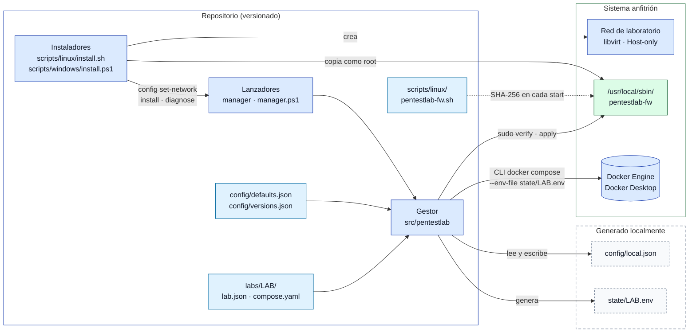
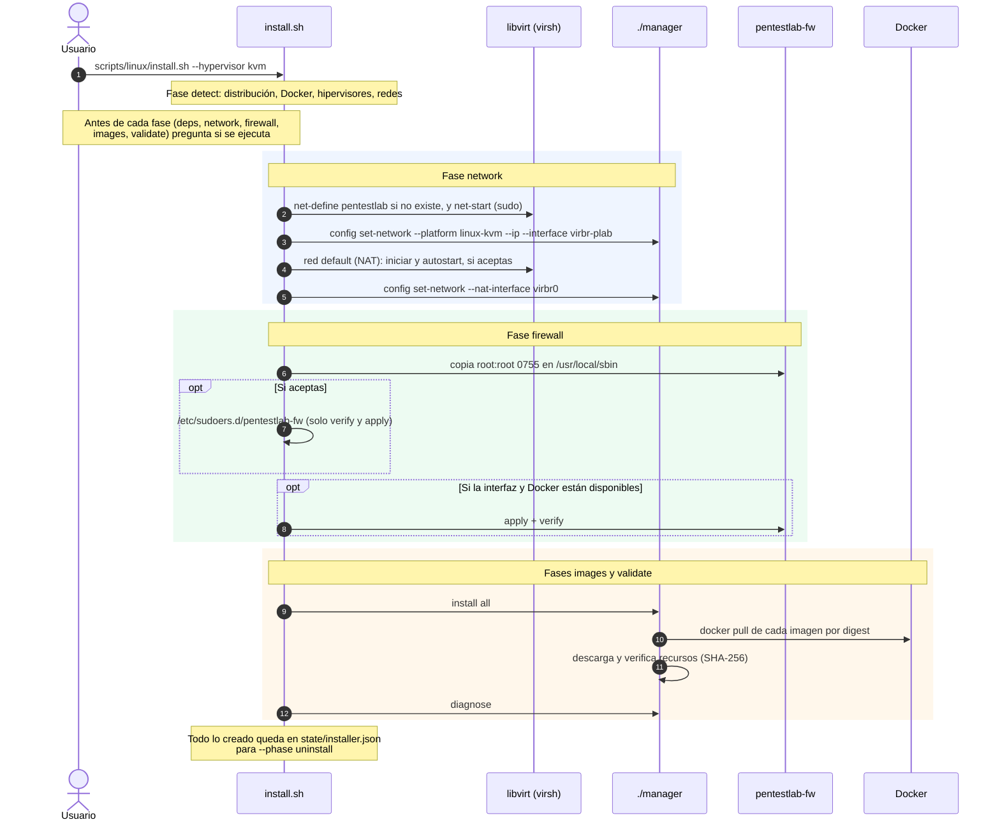
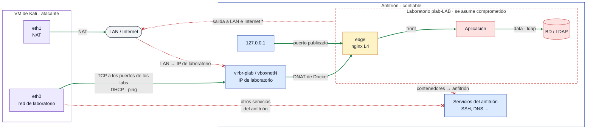
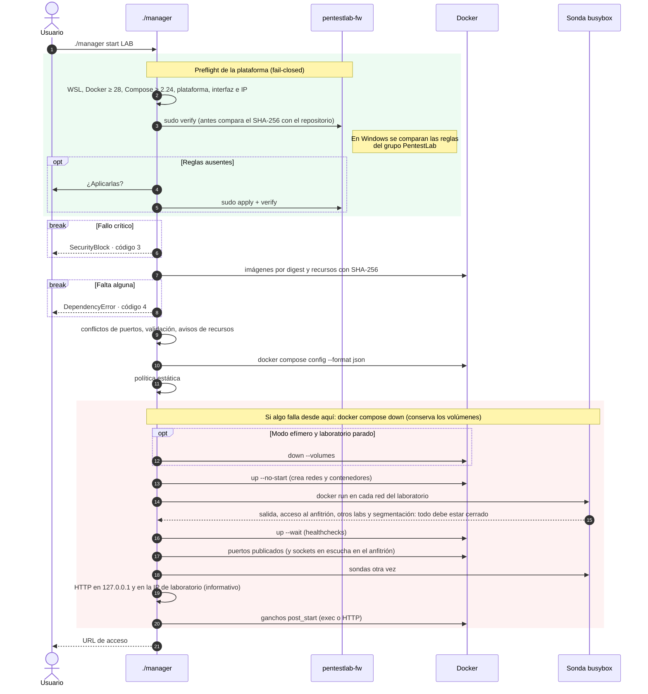
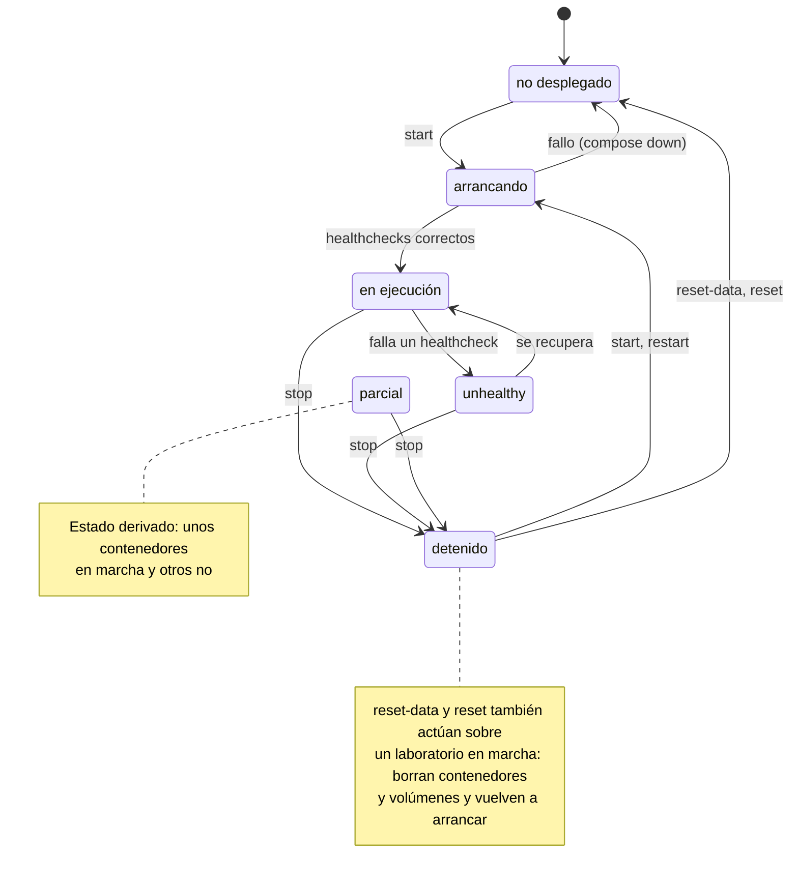
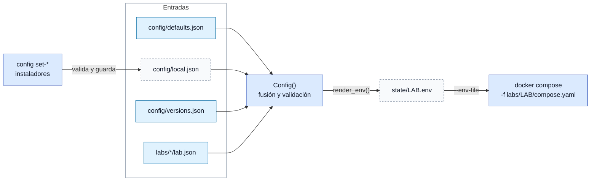

# Arquitectura

Visión de conjunto de los componentes del laboratorio, cómo se relacionan y por qué están organizados así. Describe la implementación actual; las decisiones de fondo están en los [ADR](#6-decisiones-de-diseño-adr) y las garantías que no se pueden debilitar, en las [invariantes de seguridad](invariantes-seguridad.md).

## 1. Objetivo del diseño

El laboratorio despliega aplicaciones **vulnerables a propósito** en el equipo de cada participante. Todo el diseño parte de una premisa: **las aplicaciones se van a comprometer**. Por eso:

- solo deben ser accesibles desde la VM de Kali y desde el propio anfitrión;
- no deben tener salida a Internet ni a la LAN, ni verse entre ellas;
- un error de configuración debe impedir el despliegue (*fail-closed*), nunca exponer el laboratorio.

## 2. Componentes

| Componente | Ubicación | Responsabilidad |
|---|---|---|
| Lanzadores | `manager`, `manager.ps1` | Comprueban Python ≥ 3.10 y ejecutan `python -m pentestlab` con `src/` en el `PYTHONPATH` |
| Gestor | `src/pentestlab/` | Toda la lógica: CLI, menú, ciclo de vida, política, sondas, firewall de Windows. Solo biblioteca estándar ([ADR 0003](../adr/0003-gestor-python-biblioteca-estandar.md)) |
| Definición de laboratorios | `labs/<lab>/` | `lab.json` (metadatos que lee el gestor), `compose.yaml` (servicios y redes) y `edge.conf.stream-template` (escuchas del proxy) |
| Proxy común | `labs/_common/edge/` | Servicio `edge` endurecido que cada laboratorio extiende (`extends`) y `nginx.conf` en modo `stream` (L4) |
| Configuración | `config/` | `defaults.json` (no se edita), `versions.json` (conjunto de versiones probado) y `local.json` (configuración de cada equipo, no versionada) |
| Estado generado | `state/` | `<lab>.env` para Compose, recursos descargados (LDIF de Mutillidae), `installer.json` y registros. No se versiona |
| Instaladores | `scripts/linux/install.sh`, `scripts/windows/install.ps1` | Lo que exige el sistema: red del hipervisor, firewall, dependencias. El resto lo delegan en el gestor |
| Firewall de Linux | `scripts/linux/pentestlab-fw.sh` | Cadenas iptables propias del laboratorio ([detalle](../networking/firewall-linux.md)) |
| Kit de Kali | `kali/` | Instalación y verificación de herramientas dentro de la VM ([detalle](../kali/preparacion.md#3-kit-de-herramientas-kaliinstallsh)) |
| Pruebas | `tests/` | Unitarias, de política sobre los compose reales y de red con paquetes reales ([detalle](../testing/pruebas.md)) |

### Módulos del gestor

| Módulo | Qué contiene |
|---|---|
| `cli.py` | Analizador de argumentos (`argparse`) y despacho de comandos, incluidos los subcomandos `config` |
| `menu.py` | Menú interactivo; llama a las mismas operaciones que la CLI |
| `lifecycle.py` | Clase `Manager`: `install`, `start`, `stop`, `restart`, `reset-data`, `reset`, `update`, `status`, `logs`, `network-check`, `diagnose` y ganchos `post_start` |
| `config.py` | Carga y fusiona `defaults.json` + `local.json`, lee `labs/*/lab.json`, valida y genera `state/<lab>.env`. Es el único módulo que escribe `config/local.json` |
| `policy.py` | Política estática sobre la salida de `docker compose config --format json` |
| `isolation.py` | Comprobaciones con conexiones reales (sondas busybox), puertos publicados, sockets, HTTP, verificación de `pentestlab-fw` y especificación/verificación de las reglas del Firewall de Windows |
| `docker.py` | Envoltorio fino de la CLI de Docker y comprobación de versiones mínimas |
| `hostenv.py` | Consultas de solo lectura al sistema: SO, interfaces, memoria, propietario de un puerto, zona horaria, hipervisores |
| `ports.py` | Detección de puertos ocupados y propuesta de alternativas |
| `resources.py` | Avisos de CPU y memoria antes de arrancar y consumo actual |
| `updates.py` | `update --check`: consulta Docker Hub y GHCR sin aplicar nada |
| `ui.py`, `errors.py` | Mensajes al usuario (en español, con "Cómo solucionarlo") y códigos de salida |

### Instalación guiada (Linux con KVM)

El instalador solo hace lo que exige el sistema y delega el resto en el gestor ([ADR 0003](../adr/0003-gestor-python-biblioteca-estandar.md)). Con VirtualBox, la fase `network` usa `VBoxManage` en lugar de `virsh` y no registra red NAT.

## 3. Topología de red y límites de confianza

Tres zonas con distinto nivel de confianza: la VM de Kali (atacante), el anfitrión y cada laboratorio, que se trata como **comprometido**. En verde, las conexiones permitidas; en rojo punteado, las que bloquean las redes internas de Docker y el firewall del anfitrión.

\* En Windows, el proxy `edge` sí tiene salida: es un riesgo residual aceptado ([ADR 0002](../adr/0002-salida-del-proxy-firewall-y-dns.md)). Además, el anfitrión no enruta hacia la LAN ni hacia Internet nada de lo que Kali envía por `eth0`. La segmentación detallada de cada laboratorio está en [configuración de red](../networking/README.md#4-redes-docker-de-cada-laboratorio).

Tres capas se complementan:

1. **Docker.** Las aplicaciones y sus servicios auxiliares solo están en redes `internal: true`. El proxy `edge` es el único contenedor en una red no interna y el único que publica puertos, solo en `127.0.0.1` y en la IP de laboratorio.
2. **Firewall del anfitrión.** Cubre lo que Docker no puede: la salida del proxy, el acceso de los contenedores al anfitrión, la LAN hacia la IP de laboratorio y que el anfitrión enrute el tráfico de Kali. En Linux es `pentestlab-fw`; en Windows, las reglas del grupo `PentestLab`, con [riesgos residuales documentados](../installation/windows.md#7-diferencias-y-riesgos-residuales).
3. **Comprobaciones del gestor.** Política estática y conexiones reales antes y después de cada arranque.

El detalle de subredes, bridges, puertos y DNS está en [configuración de red](../networking/README.md).

## 4. Ciclo de vida de los laboratorios

### Qué hace `start`

Si falla una comprobación de seguridad (preflight, política, sondas o verificación posterior), el código de salida es 3; si el laboratorio no llega a estar sano o falla un gancho, es 1. Cualquier excepción a partir de `up --no-start`, incluida la interrupción con Ctrl+C, ejecuta `docker compose down --remove-orphans` antes de propagarse (`lifecycle.py`, `_start_one`). Los volúmenes se conservan.

Las operaciones destructivas (`reset-data`, `reset`) piden escribir el identificador del laboratorio y después pasan por el mismo `start` completo. `restart` es `stop` + `start` conservando los datos. Detalle de cada comando: [uso del gestor](../management/gestor.md).

### Estados de un laboratorio

El estado no se guarda en ningún sitio: `./manager status` lo deduce de los contenedores del proyecto `plab-<lab>` (`Manager.state` en `lifecycle.py`), sin contar los de inicialización ni las sondas.

## 5. Flujo de configuración

- Los laboratorios se **descubren** recorriendo `labs/*/lab.json`. No hay un registro central.
- `state/<lab>.env` se regenera en cada operación con las imágenes (`repositorio:tag@digest`), puertos, IP de laboratorio, límites y zona horaria. Por eso los `compose.yaml` usan `${VAR:?}` y fallan si se ejecutan fuera del gestor.
- Solo `config/local.json` se escribe, siempre de forma atómica (archivo temporal + `os.replace`).

## 6. Decisiones de diseño (ADR)

| ADR | Decisión |
|---|---|
| [0001](../adr/0001-arquitectura-proxy-l4-redes-internas.md) | Proxy nginx L4 por laboratorio; aplicaciones solo en redes internas; publicación en `127.0.0.1` y en la IP de laboratorio |
| [0002](../adr/0002-salida-del-proxy-firewall-y-dns.md) | Firewall propio y verificado en el anfitrión; DNS del proxy a `127.0.0.1`; riesgos residuales en Windows |
| [0003](../adr/0003-gestor-python-biblioteca-estandar.md) | Gestor en Python con solo la biblioteca estándar; instaladores nativos finos |
| [0004](../adr/0004-fijado-de-versiones.md) | Imágenes fijadas por tag y digest; recursos por commit y SHA-256 |

Una propuesta que cambie alguna de estas decisiones debe añadir un ADR nuevo (`docs/adr/NNNN-titulo.md`, con las secciones *Contexto*, *Decisión*, *Alternativas descartadas* y *Consecuencias*) en lugar de reescribir el existente. Ver [CONTRIBUTING](../../CONTRIBUTING.md#decisiones-de-arquitectura).

## 7. Limitaciones conocidas

- **Windows no está probado.** La salida del proxy queda abierta con Docker Desktop y el acceso de los contenedores al anfitrión depende de Docker Desktop: el gestor lo muestra como aviso, no como fallo ([ADR 0002](../adr/0002-salida-del-proxy-firewall-y-dns.md)).
- **El firewall de Linux no persiste.** Tras reiniciar, nada está expuesto (ningún servicio arranca solo), pero en KVM Kali no tiene Internet hasta el siguiente `start`.
- **Solo Docker con backend `iptables`.** Docker rootless, Docker Desktop para Linux y el backend `nftables` se bloquean ([compatibilidad](../compatibilidad.md#no-soportado)).
- **El gestor no ve el tráfico de otras interfaces.** Las sondas se ejecutan dentro de Docker; lo que ve la LAN o Kali se comprueba con las [pruebas de red](../testing/pruebas.md) (niveles 3 a 5).
- **Algunos scripts asumen los puertos por defecto.** `tests/network/kali-probe.sh` comprueba siempre los 6 puertos por defecto y no tiene opción para otros; `kali/install.sh --check` admite `--ports`. Si cambias puertos con `set-port`, sus resultados no son fiables.
- **La interacción con Docker depende de la salida JSON de su CLI**, que puede cambiar entre versiones ([ADR 0003](../adr/0003-gestor-python-biblioteca-estandar.md#consecuencias)).
