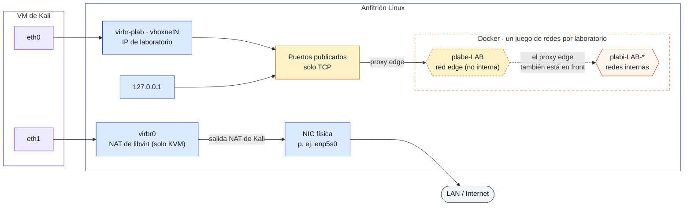
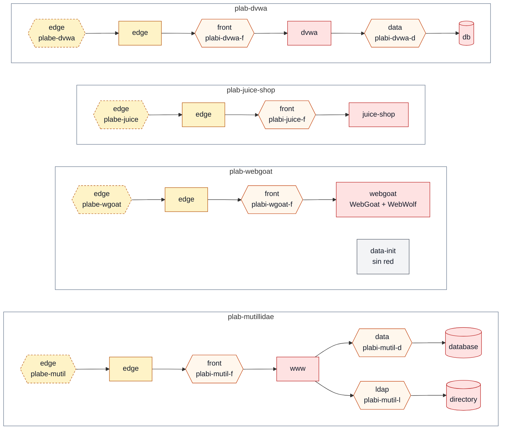

# Configuración de red

## 1. Vista general

Interfaces del anfitrión que intervienen y por dónde pasa cada tráfico. Las flechas indican el sentido en que se abren las conexiones.



Con VirtualBox, el NAT de Kali funciona en espacio de usuario y no hay `virbr0`. Qué conexiones están permitidas y cuáles bloqueadas: [topología y límites de confianza](../architecture/README.md#3-topología-de-red-y-límites-de-confianza).

Hay tres capas que se complementan:

1. **Docker.**
   - Las aplicaciones solo están en redes `internal: true`, sin pasarela.
   - El proxy `edge` es el único contenedor en una red no interna y el único que publica puertos: en `127.0.0.1` y en la IP de laboratorio.
2. **Firewall del anfitrión** ([`pentestlab-fw`](firewall-linux.md)). Cubre lo que Docker no puede:
   - la salida del proxy;
   - el acceso de los contenedores al anfitrión;
   - que la LAN alcance la IP de laboratorio;
   - que el anfitrión haga de router para lo que Kali envía por la red de laboratorio;
   - en KVM, el NAT de la segunda NIC de Kali, que Docker rompería ([ver abajo](#kali-y-su-nic-nat)).
3. **Comprobaciones del gestor.** Antes y después de cada arranque intenta conexiones reales y bloquea el despliegue si alguna debería fallar y no falla (*fail-closed*).

La justificación está en el [ADR 0001](../adr/0001-arquitectura-proxy-l4-redes-internas.md) y el [ADR 0002](../adr/0002-salida-del-proxy-firewall-y-dns.md).

## 2. Subredes de laboratorio

| Plataforma | Interfaz | IP del anfitrión | DHCP |
|---|---|---|---|
| `linux-kvm` | `virbr-plab` (red libvirt `pentestlab`) | `192.168.157.1/24` | `.100`–`.199` (dnsmasq de libvirt), sin pasarela ni DNS |
| `linux-virtualbox` | `vboxnetN` (Host-only nueva) | `192.168.57.1/24` | `.100`–`.199` (DHCP de VirtualBox, servidor `.2`), sin pasarela ni DNS |

### Kali y su NIC NAT

Kali tiene dos adaptadores, como piden los requisitos del taller: el de laboratorio y uno NAT para Internet. El DHCP de la red de laboratorio **no anuncia pasarela**, de modo que la ruta por defecto de Kali va siempre por el NAT.

| Hipervisor | NAT de Kali | Qué hace el laboratorio |
|---|---|---|
| KVM | Red libvirt `default`, bridge `virbr0` en el anfitrión | `pentestlab-fw --nat-iface virbr0`: DHCP/DNS y reenvío hacia fuera; nada hacia el anfitrión, el laboratorio ni Docker ([firewall](firewall-linux.md#plab-fwd-tráfico-reenviado)). El bridge se guarda como `nat_interface` en `config/local.json` |
| VirtualBox | NAT en espacio de usuario (sin bridge) | Nada: no pasa por iptables |

El NAT da a Kali acceso a Internet y a tu LAN, como a cualquier VM. Lo que el diseño exige es que **las aplicaciones** no tengan salida y que no sean accesibles desde la LAN, y eso no cambia.

Reglas para la IP de laboratorio (las aplican el instalador y el gestor):

- debe ser IPv4 privada (RFC 1918): ni `0.0.0.0`, ni loopback, ni link-local;
- su subred no puede solaparse con ninguna otra interfaz del anfitrión;
- ninguna otra interfaz puede tener direcciones dentro de esa subred;
- el nombre de la interfaz no puede empezar por `plab`, porque es el prefijo reservado de los bridges de Docker.

### Cambiar la subred

1. Detén los laboratorios: `./manager stop all`.
2. Elimina la red actual. Con `scripts/linux/install.sh --phase uninstall` se quita también el firewall. Si solo quieres borrar la red KVM:

   ```bash
   virsh -c qemu:///system net-destroy pentestlab
   virsh -c qemu:///system net-undefine pentestlab
   ```

3. Vuelve a crearla con la nueva IP: `scripts/linux/install.sh --phase network --hypervisor kvm --ip 192.168.158.1`.
4. `./manager start`. El firewall se vuelve a aplicar para la nueva IP; acepta cuando lo ofrezca.

`./manager config set-network` existe, pero lo usa el instalador: solo cambia `config/local.json`, no crea la interfaz.

## 3. Puertos

| Laboratorio | Endpoint | Puerto | Variable |
|---|---|---:|---|
| DVWA | `http` | 4280 | `DVWA_PORT` |
| Juice Shop | `http` | 3000 | `JUICE_SHOP_PORT` |
| WebGoat | `http` | 8080 | `WEBGOAT_PORT` |
| WebGoat | `webwolf` | 9090 | `WEBWOLF_PORT` |
| Mutillidae | `http` | 8081 | `MUTILLIDAE_PORT` |
| Mutillidae | `https` | 8443 | `MUTILLIDAE_HTTPS_PORT` |

- Cámbialos con `./manager config set-port LAB ENDPOINT PUERTO` (rango 1024–65535, sin repetir entre laboratorios).
- Solo se publica TCP.
- Si al arrancar un puerto está ocupado, el gestor muestra el proceso y propone otro; nunca lo cambia sin permiso. Ver [uso del gestor](../management/gestor.md#4-conflictos-de-puertos).
- Los scripts que se ejecutan en Kali asumen los puertos por defecto: `kali/install.sh --check` admite `--ports` para otros, pero `tests/network/kali-probe.sh` no ([detalle](../testing/pruebas.md#3-desde-la-vm-de-kali)).

## 4. Redes Docker de cada laboratorio

Los bridges tienen nombre fijo (máximo 15 caracteres) para que el firewall los reconozca: `plabe-*` para la red del proxy y `plabi-*` para las internas.

| Laboratorio | Red | Bridge | Interna | Servicios |
|---|---|---|---|---|
| DVWA | `edge` | `plabe-dvwa` | no | edge |
| | `front` | `plabi-dvwa-f` | sí | edge, dvwa |
| | `data` | `plabi-dvwa-d` | sí | dvwa, db |
| Juice Shop | `edge` | `plabe-juice` | no | edge |
| | `front` | `plabi-juice-f` | sí | edge, juice-shop |
| WebGoat | `edge` | `plabe-wgoat` | no | edge |
| | `front` | `plabi-wgoat-f` | sí | edge, webgoat |
| Mutillidae | `edge` | `plabe-mutil` | no | edge |
| | `front` | `plabi-mutil-f` | sí | edge, www |
| | `data` | `plabi-mutil-d` | sí | www, database |
| | `ldap` | `plabi-mutil-l` | sí | www, directory |

El servicio auxiliar `data-init` de WebGoat (busybox, se ejecuta una vez) corre con `network_mode: none`.

El mismo reparto, en diagrama. Los hexágonos son las redes (en discontinuo, la única no interna) y las flechas, el sentido en que se abren las conexiones permitidas. No hay ninguna conexión entre proyectos.



Consecuencias:
- el proxy no ve la base de datos;
- la base de datos no ve el proxy;
- ningún laboratorio ve a otro.

IPv6 está desactivado en todas las redes (la política lo exige).

## 5. DNS

- **Aplicaciones**: usan el DNS embebido de Docker (`127.0.0.11`). En redes internas solo resuelve nombres del propio laboratorio.
- **Proxy `edge`**: tiene `dns: ["127.0.0.1"]`.
  - El DNS embebido de Docker, en una red no interna, reenvía las consultas externas desde el espacio de red del *anfitrión*, saltándose el firewall.
  - Con un servidor de loopback, Docker sigue resolviendo los nombres internos (nginx los busca en `127.0.0.11` para encontrar la aplicación), pero las consultas externas van al loopback del contenedor, donde no escucha nada.
  - Detalle en el [ADR 0002](../adr/0002-salida-del-proxy-firewall-y-dns.md).
- **Kali**: la red de laboratorio no ofrece DNS. Kali resuelve nombres por su NIC NAT y accede a los laboratorios por IP.

## 6. Qué se comprueba en cada arranque

`./manager start` (y `./manager network-check` sobre los laboratorios en marcha):

1. Plataforma, Docker ≥ 28, interfaz de laboratorio con su IP, solapamientos y firewall (`pentestlab-fw verify`).
2. Política estática sobre `docker compose config` (ver [uso del gestor](../management/gestor.md#3-qué-hace-start)).
3. **Sondas reales** desde un contenedor busybox conectado a cada red del laboratorio y con el mismo DNS que sus contenedores:
   - salida a Internet (TCP a 1.1.1.1:443, 9.9.9.9:53 y 8.8.8.8:443, y DNS de `example.com`);
   - acceso al anfitrión: el gestor abre un puerto de escucha temporal en la pasarela de cada red y comprueba que ningún contenedor llega a conectar;
   - alcance de los contenedores de otros laboratorios;
   - segmentación entre redes del mismo laboratorio.
4. Tras arrancar: puertos publicados solo en las IP permitidas, sockets en escucha y HTTP en `127.0.0.1` y en la IP de laboratorio.

Lo que el gestor **no** puede comprobar por sí mismo es el tráfico que llega desde otra interfaz (LAN o Kali). Para eso están las [pruebas de red con paquetes reales](../testing/pruebas.md).
