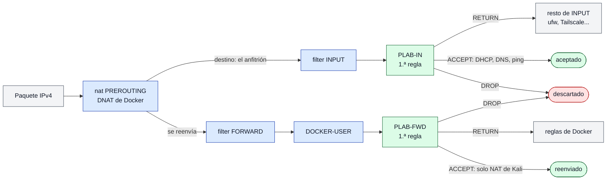

# Firewall en Linux: `pentestlab-fw`

`pentestlab-fw` es un script Bash que mantiene **sus propias** cadenas de iptables. Su código fuente está en `scripts/linux/pentestlab-fw.sh` y se instala como `/usr/local/sbin/pentestlab-fw` (root:root, 0755) con `scripts/linux/install.sh --phase firewall`.

- No vacía ni modifica ninguna otra regla del sistema.
- Solo crea tres cadenas: `PLAB-FWD`, `PLAB-IN` y `PLAB-IN6`.
- Añade un único salto a cada una.

## 1. Por qué hace falta

Docker por sí solo no puede garantizar el aislamiento (ver el [ADR 0002](../adr/0002-salida-del-proxy-firewall-y-dns.md)):

- El proxy `edge` necesita una red **no interna** para publicar puertos, y una red no interna tiene salida a Internet y a la LAN con cualquier modo de pasarela de Docker.
- Desde cualquier red de Docker, incluidas las internas, los contenedores alcanzan los servicios del anfitrión que escuchan en `0.0.0.0` a través de la IP de la pasarela.
- Linux acepta paquetes dirigidos a cualquiera de sus IP por cualquier interfaz. Un equipo de la LAN que añada una ruta hacia la IP de laboratorio podría llegar a los puertos publicados.
- El anfitrión tiene el reenvío IP activo (lo activa Docker). Sin reglas, Kali podría usarlo como router hacia la LAN o Internet.
- Docker pone la política de `FORWARD` en DROP. Eso rompe el NAT de libvirt que usa la segunda NIC de Kali en KVM. Si además ufw deniega lo entrante, Kali tampoco recibe IP por DHCP en esa red.

## 2. Uso

```text
pentestlab-fw {apply|verify|remove|status} [--ip IP --iface IFACE [--nat-iface IFACE]]
  apply   crea/actualiza las reglas (idempotente)
  verify  devuelve 0 solo si las reglas activas coinciden exactamente
  remove  elimina únicamente las cadenas y saltos PLAB-*
  status  muestra las reglas actuales
```

Normalmente no se ejecuta a mano: `./manager start` llama a `sudo pentestlab-fw verify --ip <IP> --iface <interfaz> [--nat-iface <bridge NAT>]` y, si falla, ofrece `apply`. `--nat-iface` se usa solo con KVM: es el bridge de la red NAT de Kali (`virbr0`), guardado como `nat_interface` en `config/local.json`.

Comandos útiles:

```bash
sudo pentestlab-fw status
sudo iptables -L PLAB-FWD -v -n --line-numbers     # con contadores de paquetes por regla
sudo iptables -L PLAB-IN  -v -n --line-numbers
sudo pentestlab-fw remove                          # quitar las reglas (start las volverá a ofrecer)
```

## 3. Reglas

Dónde se engancha cada cadena en el recorrido de un paquete IPv4. `PLAB-IN6` se engancha igual en la cadena `INPUT` de `ip6tables`.



El resultado depende de la primera regla que coincide; las tablas siguientes las detallan en orden.

Las variables son:
- `IP`: la IP de laboratorio;
- `IFACE`: la interfaz de laboratorio (`virbr-plab` o `vboxnetN`);
- `plab+`: cualquier bridge de laboratorio de Docker;
- `plabe+`: solo los bridges de los proxies;
- `NAT`: el bridge de la NIC NAT de Kali (`virbr0`). Sus reglas solo existen si se pasa `--nat-iface`.

### `PLAB-FWD` (tráfico reenviado)

Es la **primera regla de `DOCKER-USER`**. Docker evalúa esa cadena desde `FORWARD` antes que sus propias reglas.

Con `--nat-iface`, al principio:

| # | Regla | Efecto |
|---|---|---|
| N1 | `-o NAT --ctstate RELATED,ESTABLISHED -j ACCEPT` | Las respuestas hacia Kali por NAT se aceptan aquí. Un `RETURN` las llevaría a la política DROP de Docker |
| N2 | `-i NAT -o plab+ -j DROP` | Desde el NAT no se llega a los bridges del laboratorio |
| N3 | `-i NAT -o IFACE -j DROP` | Ni a la red de laboratorio |
| N4–N5 | `-i NAT -o docker0 -j RETURN`, `-i NAT -o br-+ -j RETURN` | Otras redes Docker tuyas (no del laboratorio) siguen las reglas de Docker; no se abren |
| N6 | `-i NAT -j ACCEPT` | El resto del tráfico de Kali por NAT sale (Internet y LAN, como cualquier VM con NAT) |

Después, siempre:

| # | Regla | Efecto |
|---|---|---|
| 1 | `-m conntrack --ctstate RELATED,ESTABLISHED -j RETURN` | Las respuestas de conexiones ya permitidas siguen su curso |
| 2 | `! -i IFACE -m conntrack --ctorigdst IP/32 -j DROP` | Una conexión dirigida a la IP de laboratorio que **no** entra por la interfaz de laboratorio se descarta. Así se bloquea a un equipo de la LAN que enrute hacia la IP de laboratorio. `ctorigdst` es el destino antes del DNAT de Docker |
| 3 | `-m physdev --physdev-is-bridged -j RETURN` | El tráfico dentro de un mismo bridge (app ↔ base de datos) no se toca |
| 4 | `-i plab+ -j DROP` | Nada nuevo sale de un bridge de laboratorio hacia otro sitio: ni Internet, ni LAN, ni otros labs. Esto incluye al proxy |
| 5 | `-i IFACE ! -o plabe+ -j DROP` | Lo que entra desde Kali solo puede ir a los bridges de los proxies (tras el DNAT de los puertos publicados). El anfitrión no enruta a Kali hacia ningún otro sitio |
| 6 | `-o IFACE -j DROP` | Nada nuevo se reenvía hacia Kali desde otras interfaces |
| 7 | `-j RETURN` | El resto del tráfico del sistema sigue con las reglas de Docker y del sistema |

### `PLAB-IN` (tráfico dirigido al propio anfitrión)

Es la **primera regla de `INPUT`**.

| # | Regla | Efecto |
|---|---|---|
| 1 | `-i lo -j RETURN` | El loopback no se toca (el anfitrión usa `127.0.0.1:<puerto>`) |
| 2 | `--ctstate RELATED,ESTABLISHED -j RETURN` | Respuestas |
| 3 | `-i plab+ -j DROP` | Los contenedores no pueden abrir conexiones hacia servicios del anfitrión |
| 4 | `-d IP/32 ! -i IFACE -j DROP` | La IP de laboratorio solo se alcanza desde la interfaz de laboratorio |
| 5 | `-i IFACE -p udp --dport 67 -j ACCEPT` | DHCP para Kali |
| 6–7 | `-i IFACE -p udp/tcp --dport 53 -j ACCEPT` | DNS del dnsmasq de libvirt. La red `pentestlab` lo crea desactivado, así que no escucha nada |
| 8 | `-i IFACE -p icmp --icmp-type 8 -j ACCEPT` | Ping de Kali al anfitrión |
| 9 | `-i IFACE -j DROP` | Cualquier otro servicio del anfitrión (SSH, KDE Connect, LLMNR...) queda bloqueado para Kali |
| N | Con `--nat-iface`: `-i NAT` acepta UDP 67 (DHCP) y UDP/TCP 53 (DNS de libvirt) y descarta lo demás | Kali obtiene IP y DNS por NAT, pero no alcanza servicios del anfitrión por esa vía |
| 10 | `-j RETURN` | El resto sigue con las reglas del sistema (ufw, etc.) |

Kali llega a los puertos de los laboratorios por `FORWARD` (DNAT de Docker), no por `INPUT`. Por eso la regla 9 no les afecta.

### `PLAB-IN6` (IPv6)

Es la primera regla de `INPUT` en `ip6tables`. Las redes de laboratorio no tienen IPv6, pero el anfitrión sí puede escuchar en `::`.

| # | Regla | Efecto |
|---|---|---|
| 1–2 | `lo` y `RELATED,ESTABLISHED` → `RETURN` | |
| 3 | `-i plab+ -j DROP` | Contenedores → anfitrión por IPv6 |
| 4 | `-i IFACE -p ipv6-icmp -j RETURN` | Se mantiene el descubrimiento de vecinos |
| 5 | `-i IFACE -j DROP` | Kali → servicios del anfitrión por IPv6 |
| N | Con `--nat-iface`: lo mismo para `NAT` (ICMPv6 sí, el resto no) | |

## 4. Prefijo reservado `plab`

Las reglas filtran por nombre de interfaz (`-i plab+`). Por eso:

- todos los bridges de Docker del laboratorio se llaman `plabe-*` o `plabi-*` (lo exige la política del gestor);
- **la interfaz de laboratorio no puede empezar por `plab`**. Si lo hiciera, la regla 3 de `PLAB-IN` descartaría el tráfico de Kali. `pentestlab-fw` y `./manager` rechazan esa configuración;
- tampoco conviene crear otras interfaces con ese prefijo en el anfitrión.

## 5. Verificación

`verify` devuelve 0 solo si se cumple todo lo siguiente:

1. `PLAB-FWD`, `PLAB-IN` y `PLAB-IN6` coinciden **exactamente** con las esperadas. Para compararlas, carga las reglas esperadas en una cadena temporal y deja que iptables las normalice, de modo que se compara lo mismo con lo mismo.
2. El salto a `PLAB-FWD` es la **primera** regla de `DOCKER-USER`, y el de `PLAB-IN`/`PLAB-IN6`, la primera de `INPUT`.
3. `FORWARD` salta a `DOCKER-USER`.
4. `net.bridge.bridge-nf-call-iptables = 1`, es decir, `br_netfilter` está cargado. Sin esto, el tráfico entre bridges no pasaría por iptables (`apply` carga el módulo).

Además, antes de llamar a `verify`, el gestor comprueba que **el SHA-256 de `/usr/local/sbin/pentestlab-fw` coincide con el de `scripts/linux/pentestlab-fw.sh`**. Si el repositorio trae una versión nueva del script, hay que reinstalarlo (`scripts/linux/install.sh --phase firewall`).

## 6. No persistencia

Las reglas solo existen en memoria y **desaparecen al reiniciar**. Es intencionado:

- tras un reinicio ningún laboratorio arranca solo (`restart: "no"`);
- `./manager start` verifica las reglas antes de exponer nada y ofrece aplicarlas;
- no se deja ninguna regla permanente en el sistema que haya que recordar quitar.

Si otro programa recarga el firewall y borra las cadenas, o inserta reglas por delante, `verify` falla y el siguiente `start` se bloquea hasta reaplicarlas.

## 7. Convivencia con otros firewalls

| Componente | Estado | Notas |
|---|---|---|
| **ufw** | Probado | Sus cadenas siguen en `INPUT`/`FORWARD` después de los saltos `PLAB-*`. El `ACCEPT` de DHCP en `PLAB-IN` evita que ufw bloquee el DHCP de Kali. El resto vuelve con `RETURN` a las reglas de ufw |
| **Tailscale** | Probado | Sus cadenas `ts-*` no interfieren. Si al reiniciarse `tailscaled` inserta reglas por delante, `verify` lo detecta y `start` ofrece reaplicar |
| **libvirt** (backend nftables) | Probado | libvirt usa su propia tabla nftables. Un paquete tiene que ser aceptado por todas las tablas, así que los `DROP` de `PLAB-FWD` prevalecen. Por la misma razón, el NAT de libvirt necesita los `ACCEPT` de `--nat-iface` |
| **Docker** | Probado | Solo se usa su cadena `DOCKER-USER`, pensada para esto |
| firewalld | No probado | |
| Backend `nftables` de Docker | No soportado | Sin `DOCKER-USER` de iptables; el gestor bloquea el despliegue |

## 8. Comprobar con paquetes reales

El firewall se valida con:
- tráfico desde una LAN emulada (`sudo tests/network/linux-netns.sh test`);
- tráfico desde la VM de Kali (`tests/network/kali-probe.sh`).

Ver [pruebas](../testing/pruebas.md).
