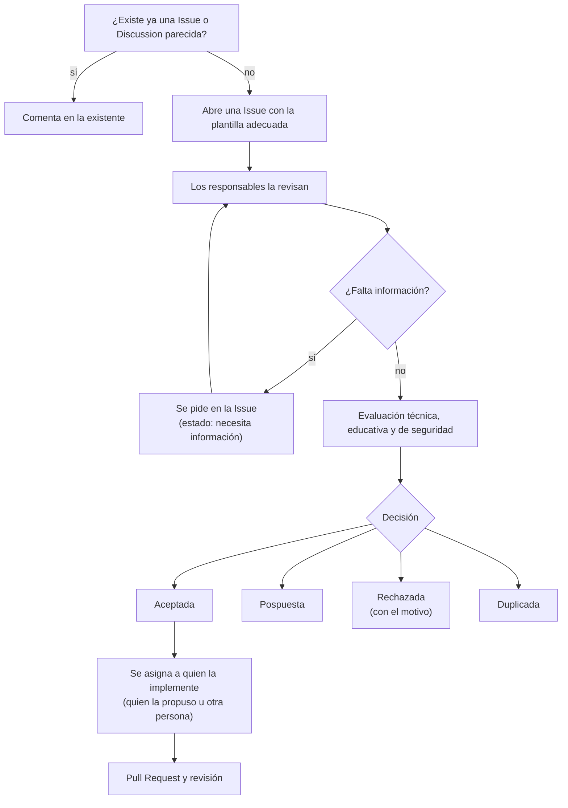

# El proyecto: objetivos, principios y participación

## 1. Qué es y para quién

Web Workshop es la infraestructura del taller de seguridad web de **Hackers Factory CTF Team**. Cada participante ejecuta en su propio equipo un laboratorio local y aislado: aplicaciones vulnerables a propósito en Docker que se atacan desde una VM de Kali Linux.

El repositorio lo usan cuatro perfiles:

| Perfil | Qué hace | Por dónde empezar |
|---|---|---|
| **Participantes** | Instalan el laboratorio y lo usan durante el taller | [README](../../README.md#inicio-rápido) y [guía de uso](../README.md#participantes-instalar-y-usar-el-laboratorio) |
| **Colaboradores** | Proponen laboratorios, ejercicios, mejoras o documentación, con o sin código | [CONTRIBUTING](../../CONTRIBUTING.md) |
| **Desarrolladores** | Trabajan en el gestor, la infraestructura, los scripts y las pruebas | [Guía de desarrollo](../development/README.md) |
| **Responsables** | Mantienen el repositorio, evalúan propuestas y revisan contribuciones | Este documento y la [configuración de GitHub](configuracion-github.md) |

## 2. Principios

Estos principios explican muchas decisiones del repositorio. Una propuesta que vaya contra alguno necesita una justificación sólida.

1. **Seguridad primero.** Las aplicaciones se van a comprometer: el aislamiento no es negociable y el despliegue es *fail-closed*. Ver las [invariantes de seguridad](../architecture/invariantes-seguridad.md).
2. **Local y sin dependencias de red.** Después de la instalación, el laboratorio funciona sin Internet. Nada se expone a la LAN.
3. **Reproducible.** Todos los participantes usan las mismas versiones, fijadas por digest y validadas ([ADR 0004](../adr/0004-fijado-de-versiones.md)).
4. **Fácil de instalar y de auditar.** Python con la biblioteca estándar, instaladores nativos y mensajes en español que dicen cómo solucionar cada error ([ADR 0003](../adr/0003-gestor-python-biblioteca-estandar.md)).
5. **Honestidad técnica.** Solo se marca como *probado* lo que se ha ejecutado de verdad ([compatibilidad](../compatibilidad.md)). Los riesgos residuales se documentan, no se esconden.
6. **Documentación técnica, sin soluciones.** El repositorio explica cómo funciona el laboratorio, no cómo resolver los retos. Cada participante investiga por su cuenta.

## 3. Dónde participar

| Canal | Para qué | Estado |
|---|---|---|
| **Issues** | Solicitudes concretas que necesitan evaluación y seguimiento: errores, funcionalidades, mejoras, documentación y laboratorios nuevos | Activas, con [plantillas](../../.github/ISSUE_TEMPLATE/) |
| **Pull Requests** | Cambios ya implementados, normalmente asociados a una Issue | Activos, con [plantilla](../../.github/pull_request_template.md) |
| **Discussions** | Conversación abierta que aún no es una solicitud concreta: ideas preliminares, temáticas de talleres, arquitectura, experiencias, preguntas generales | **No habilitadas** a fecha de 2026-11-26 ([recomendación](configuracion-github.md#2-github-discussions)) |
| **Avisos de seguridad** | Vulnerabilidades del propio laboratorio | Ver [SECURITY.md](../../SECURITY.md) |

Regla práctica:

- **¿Tienes una idea y quieres opiniones?** Discussions (cuando estén habilitadas). Mientras tanto, una Issue con la plantilla que más se parezca, indicando que es una idea preliminar.
- **¿Sabes qué pides o qué falla?** Issue.
- **¿Ya lo has implementado?** Pull Request, enlazando la Issue.
- **¿Has encontrado una forma de romper el aislamiento?** No abras nada público: [SECURITY.md](../../SECURITY.md).

## 4. Cómo se evalúan las propuestas

1. **Busca antes** entre las Issues abiertas y cerradas.
2. **Abre una Issue** con la plantilla adecuada. No hace falta conocer la arquitectura interna ni tener la propuesta completa: se puede ir desarrollando en la conversación.
3. **Los responsables la revisan** y, si hace falta, piden información.
4. **Se evalúa** con estos criterios:
   - **técnico**: si se puede implementar con la arquitectura actual, qué mantenimiento añade y qué pruebas necesita;
   - **educativo**: si aporta al taller, a qué nivel y si duplica lo que ya ofrece otro laboratorio;
   - **seguridad**: si conserva las [invariantes](../architecture/invariantes-seguridad.md). Una propuesta que exige debilitarlas se rechaza salvo que se justifique en un ADR nuevo;
   - **recursos**: RAM, CPU y disco que añade al equipo de cada participante.
5. **Se decide**: aceptada, pospuesta, rechazada (siempre con el motivo) o marcada como duplicada.
6. **Si se acepta**, se asigna a alguien para implementarla. Quien la propuso tiene preferencia si quiere hacerlo.

> Presentar una propuesta **no garantiza** que se implemente. El equipo no ha fijado plazos de respuesta: las Issues se revisan según la disponibilidad de los responsables.

## 5. Etiquetas

El repositorio solo tiene, a fecha de 2026-11-26, las etiquetas por defecto de GitHub: `bug`, `documentation`, `duplicate`, `enhancement`, `good first issue`, `help wanted`, `invalid`, `question` y `wontfix`. Se reutilizan tal cual, y se propone añadir unas pocas para el área, el impacto y el estado de evaluación:

| Grupo | Etiquetas | Uso |
|---|---|---|
| Tipo | `bug`, `enhancement`, `documentation`, `question` (existentes) y **`laboratorio`** (nueva) | Las aplican las plantillas. `enhancement` cubre funcionalidades nuevas y mejoras; el título de la Issue las distingue |
| Área | **`área: gestor`**, **`área: red y firewall`**, **`área: laboratorios`**, **`área: instaladores`**, **`área: kali`**, **`área: windows`**, **`área: ci y pruebas`** (nuevas) | La aplican los responsables al revisar |
| Impacto | **`seguridad`** (nueva) | El cambio afecta a alguna invariante de seguridad: revisión reforzada |
| Prioridad | **`prioridad: alta`**, **`prioridad: baja`** (nuevas) | Sin etiqueta = prioridad normal |
| Estado | **`estado: pendiente de revisión`**, **`estado: necesita información`**, **`estado: aceptada`**, **`estado: pospuesta`** (nuevas); `wontfix`, `duplicate`, `invalid` (existentes) | Seguimiento de la evaluación. `wontfix` se usa para las rechazadas |
| Colaboración | `good first issue`, `help wanted` (existentes) | Issues aceptadas sin asignar |

Las plantillas ya aplican `estado: pendiente de revisión` y `laboratorio`; GitHub ignora las etiquetas que no existen, así que empezarán a aplicarse en cuanto se creen. Los comandos para crearlas están en la [configuración de GitHub](configuracion-github.md#3-etiquetas).

## 6. Decisiones de arquitectura

Las decisiones de fondo se registran como ADR en [`docs/adr/`](../adr/). Un ADR aceptado no se reescribe: si una decisión cambia, se añade uno nuevo que lo sustituye y se actualiza el estado del anterior. Ver la [arquitectura](../architecture/README.md#6-decisiones-de-diseño-adr).
